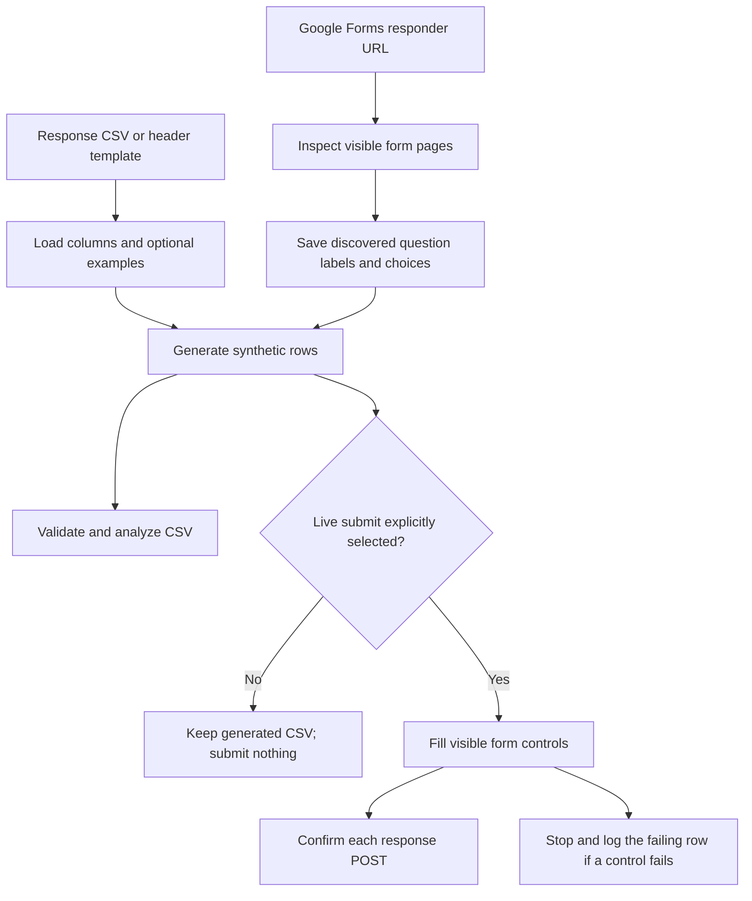

# SurveyForge AI

SurveyForge AI is a Python command-line project for inspecting survey forms, generating clearly synthetic response rows, validating and analyzing CSV data, and optionally entering those rows into a Google Form. It is intended for demos and software evaluation. Generated records are not real participants, research evidence, or representative samples.

## What happens



## Why it works this way

- **Inspect before generation.** Google Forms exposes question labels and enabled choices at runtime. Inspection records those details and can use temporary answers to reveal later sections. It never clicks Submit.
- **Generate from the form schema.** Choice answers come from the inspected options when available. Names, phone-shaped demo values, and email placeholders are synthetic. Email placeholders use the reserved `example.com` domain and are not deliverable mailboxes.
- **Validate before analysis.** The pipeline checks generated data and writes reports and charts from local CSVs.
- **Require an explicit live action.** A normal push, pull request, or local `run` does not submit responses. Live submission requires the configuration gate and an explicit `submit --live` command; GitHub Actions also requires the `submit` stage and its confirmation input.
- **Stop when the form does not match.** Unsupported controls, missing choices, CAPTCHA prompts, or required-field validation stop the current run. A printed HTTP response confirms Google received a form response; it does not establish that synthetic data is valid research.

## Repository privacy

The repository contains code, a question-schema example, and a header-only CSV template. Do not commit response exports, form PDFs, generated records, reports, credentials, or private responder/edit links. Keep source data in the ignored `data/original/` directory. The checked-in configuration leaves `submission.form_url` blank; manual GitHub Actions runs provide the responder URL to that run only. Store optional API credentials as environment variables or GitHub Actions secrets, never in source files.

The email column in a response export may be Google Forms collection metadata rather than an editable question. The filler can populate a visible email input. It cannot assign a made-up value to a hidden Google-collected account field; add a visible email question if synthetic email values need to appear as ordinary answers.

## Install

Use Python 3.10 or later:

```bash
python -m venv .venv
# Windows PowerShell: .venv\Scripts\Activate.ps1
# macOS or Linux: source .venv/bin/activate
python -m pip install -r requirements.txt
python -m playwright install chromium
```

## Local commands

```bash
python main.py inspect-form --url "https://forms.gle/FORM_ID"
python main.py generate --count 10 --seed 42
python main.py validate
python main.py analyze
python main.py run --count 10 --seed 42
python main.py submit --dry-run
```

`inspect-form` saves `data/processed/live_form_schema.json`. `generate` writes `data/synthetic/generated.csv`. `validate` writes a validation report. `analyze` summarizes the configured source CSV and writes analysis artifacts. `run` executes the local generate, normalize, validate, and analyze pipeline. `submit --dry-run` does not open the form or submit a response.

The default source path points to `data/original/responses.template.csv`. Put an authorized response export in the ignored `data/original/` directory and update `paths.original_csv` locally if you want to use its non-contact answer examples. The generator replaces recognized name, phone, and email columns with synthetic values; inspect the output before use.

## GitHub Actions

The `SurveyForge CI/CD` workflow runs on pushes and pull requests to the main branch. Manual runs are available from the repository's Actions tab. They ask for a response count, starting row, responder URL, pipeline stage, and live-submission confirmation.

Use `inspect` to inspect without submitting. Use `run`, `generate`, `validate`, or `analyze` for local pipeline stages. Use `submit` only when you intend to add real rows to the selected Google Form. For a partial batch, `start_index` skips that many leading rows from the newly generated CSV; choose it only from rows whose submission outcome you have checked. The workflow uploads generated and processed artifacts for review.

Set `XAI_API_KEY` and optionally `XAI_MODEL` as repository secrets only if using the optional xAI integration. Core generation and analysis have local rule-based paths.

## How the code is organized

| Area | Purpose |
| --- | --- |
| `main.py` | Command-line entry point |
| `src/form_inspector.py` | Opens a responder link, records visible questions and choices, and navigates sections without submitting |
| `src/data_generator.py` | Produces reproducible synthetic rows and labels them as synthetic |
| `src/form_filler.py` | Fills supported Google Forms controls, reports row-level progress, and detects confirmed form-response requests |
| `src/pipeline.py` | Connects generation, normalization, validation, and analysis |
| `src/validator.py`, `src/normalizer.py` | Validate and normalize generated tabular data |
| `src/analytics.py`, `src/dataset_analyzer.py` | Build summaries and chart/report outputs |
| `.github/workflows/survey_pipeline.yml` | Runs CI and the manually selected pipeline stage |

## Limits

The inspector discovers visible labels and controls; it does not infer research meaning, all branching rules, or every form validation rule. Login-only forms, file uploads, unusual widgets, dynamic branching, or Google anti-abuse checks may require a project-specific adapter. Review the inspected schema and generated CSV before any live submission. Synthetic data should be described as synthetic in demos and reports.
